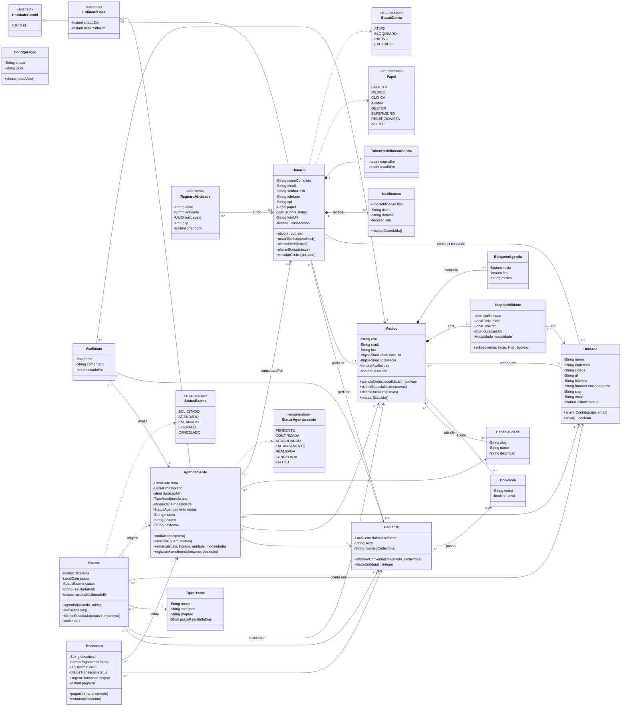

# Diagramas UML do SaúdePlus

Diagramas de **classes** e de **casos de uso** do sistema, levantados a partir do
código em 11/11/2026: entidades JPA de `backend/src/main/java/br/com/saudeplus`,
controllers REST e telas do frontend.

| Diagrama | Fonte UML (PlantUML) | Prévia nesta página |
|---|---|---|
| Classes (domínio) | [`diagrama-de-classes.puml`](diagrama-de-classes.puml) | [Diagrama de classes](#diagrama-de-classes) |
| Casos de uso | [`diagrama-de-casos-de-uso.puml`](diagrama-de-casos-de-uso.puml) | [Diagrama de casos de uso](#diagrama-de-casos-de-uso) |

Os arquivos `.puml` usam a notação UML completa: bonecos de ator, elipses,
`<<include>>`/`<<extend>>`, visibilidade e multiplicidades. Para gerar a imagem:

- **VS Code:** extensão *PlantUML* (jebbs.plantuml), abrir o `.puml` e usar `Alt+D`
  (prévia) ou *Export Current Diagram* (PNG/SVG);
- **Navegador:** colar o conteúdo em <https://www.plantuml.com/plantuml>;
- **Linha de comando:** `java -jar plantuml.jar -tsvg docs/diagramas/*.puml`.

Os `.puml` usam `!pragma layout smetana`, o layout interno do PlantUML, então não
precisam do Graphviz instalado.

As prévias abaixo, em Mermaid, mostram o mesmo conteúdo e aparecem sozinhas no
GitHub e na prévia de Markdown do VS Code. O Mermaid não tem diagrama de casos de
uso próprio, então essa prévia usa um fluxograma (atores à esquerda, casos de uso
em elipses, áreas do sistema como blocos).

> Ao mudar entidades, relacionamentos, perfis ou endpoints, atualize os dois
> formatos: o `.puml` é a referência.

---

## Diagrama de classes

Todas as entidades herdam o `id` UUID de `EntidadeComId`. `Usuario` e
`Agendamento` passam por `EntidadeBase` (`criadoEm`/`atualizadoEm`).
`Configuracao` é a exceção: a própria `chave` é o identificador.

Os demais enums aparecem no `.puml`: `StatusUnidade`, `TipoAtendimento`,
`Modalidade`, `FormaPagamento`, `StatusTransacao`, `OrigemTransacao` e
`TipoNotificacao`.

### Leitura rápida

- **Uma conta, vários papéis.** `Usuario` guarda login, senha e situação da conta.
  O papel define a área: paciente e médico têm perfil próprio (`Paciente`,
  `Medico`, 1 para 0..1), e a conta `CLINICA` fica presa a uma `Unidade`.
- **Agenda.** O médico abre janelas semanais (`Disponibilidade`) por unidade e
  bloqueia períodos (`BloqueioAgenda`). Um `Agendamento` liga paciente, médico,
  unidade e especialidade, e guarda o prontuário (`resumo`, `desfecho`).
- **Pós-consulta.** Uma consulta realizada pode gerar uma `Avaliacao` (no máximo
  uma por consulta), `Exame`s e `Transacao`ões.
- **Exclusão de conta.** `StatusConta.EXCLUIDO` tira a conta do sistema sem apagar
  os dados (LGPD). `Medico.excluido` libera o CRM para um novo cadastro.

---

## Diagrama de casos de uso

**Atores**

| Ator | Quem é | Herda de |
|---|---|---|
| Visitante | Qualquer pessoa no site, sem login | — |
| Usuário autenticado | Ator abstrato com o que toda conta faz | — |
| Paciente | Conta criada pelo cadastro público | Usuário autenticado |
| Médico | Conta criada pela administração | Usuário autenticado |
| Clínica | Conta de login de uma unidade, vê só a própria unidade | Usuário autenticado |
| Equipe administrativa | Gestor, Enfermeiro, Recepcionista, Agente: cada perfil vê só os módulos liberados | Usuário autenticado |
| Administrador | Tudo da equipe, mais permissões, auditoria e contas de administrador | Equipe administrativa |

```mermaid
flowchart LR
  Visitante(["👤 Visitante"])
  Autenticado(["👤 Usuário autenticado"])
  Paciente(["👤 Paciente"])
  Medico(["👤 Médico"])
  Clinica(["👤 Clínica"])
  Equipe(["👤 Equipe administrativa"])
  Admin(["👤 Administrador"])

  Paciente -. é um .-> Autenticado
  Medico -. é um .-> Autenticado
  Clinica -. é um .-> Autenticado
  Equipe -. é um .-> Autenticado
  Admin -. é um .-> Equipe

  subgraph SISTEMA["Sistema SaúdePlus"]
    direction LR
    subgraph PUB["Área pública"]
      UC1(["Buscar profissionais"])
      UC2(["Ver perfil, avaliações e horários"])
      UC3(["Consultar unidades"])
      UC4(["Cadastrar-se como paciente"])
      UC5(["Recuperar senha por link"])
      UC6(["Entrar no sistema"])
    end
    subgraph CONTA["Conta"]
      UC7(["Manter perfil e foto"])
      UC8(["Alterar a própria senha"])
      UC9(["Ver notificações"])
    end
    subgraph PAC["Área do paciente"]
      UC10(["Agendar consulta"])
      UC11(["Escolher horário disponível"])
      UC12(["Cancelar consulta"])
      UC13(["Remarcar consulta"])
      UC14(["Ver consultas e histórico"])
      UC15(["Avaliar atendimento"])
      UC16(["Ver exames e baixar resultado"])
      UC17(["Ver pagamentos"])
    end
    subgraph MED["Área do médico"]
      UC18(["Ver agenda do dia"])
      UC19(["Atualizar status da consulta"])
      UC20(["Registrar atendimento"])
      UC21(["Consultar pacientes e prontuário"])
      UC22(["Solicitar exame"])
      UC23(["Ver resultado de exame"])
      UC24(["Gerenciar disponibilidades"])
      UC25(["Bloquear agenda"])
      UC26(["Manter perfil profissional"])
    end
    subgraph CLI["Área da clínica"]
      UC27(["Ver painel da unidade"])
      UC28(["Vincular médico à unidade"])
      UC29(["Desvincular médico da unidade"])
    end
    subgraph ADM["Administração (por módulo)"]
      UC30(["Ver dashboard geral"])
      UC31(["Gerenciar usuários"])
      UC32(["Gerenciar clínicas e acesso da unidade"])
      UC33(["Gerenciar catálogos"])
      UC34(["Gerenciar agendamentos"])
      UC35(["Ver painel de uma unidade"])
      UC36(["Gerenciar fila de exames"])
      UC37(["Liberar resultado de exame"])
      UC38(["Gerenciar financeiro"])
      UC39(["Gerar e exportar relatórios"])
      UC40(["Manter configurações gerais"])
    end
    subgraph SOADM["Somente administrador"]
      UC41(["Definir permissões dos perfis"])
      UC42(["Consultar auditoria e sistema"])
      UC43(["Gerenciar contas de administrador"])
    end
  end

  Visitante --- UC1 & UC2 & UC3 & UC4 & UC5 & UC6
  Autenticado --- UC7 & UC8 & UC9
  Paciente --- UC10 & UC12 & UC13 & UC14 & UC15 & UC16 & UC17
  Medico --- UC18 & UC19 & UC20 & UC21 & UC22 & UC23 & UC24 & UC25 & UC26
  Clinica --- UC27 & UC28 & UC29
  Equipe --- UC30 & UC31 & UC32 & UC33 & UC34 & UC35 & UC36 & UC38 & UC39 & UC40
  Admin --- UC41 & UC42 & UC43

  UC10 -. include .-> UC11
  UC13 -. include .-> UC11
  UC2 -. extend .-> UC11
  UC15 -. extend .-> UC14
  UC22 -. extend .-> UC20
  UC37 -. extend .-> UC36
  UC43 -. extend .-> UC31
```

No Mermaid, a seta de `extend` aponta do caso que estende para o caso base,
como na UML. No `.puml`, as setas seguem a mesma convenção, com os rótulos
`<<include>>` e `<<extend>>`.

### Regras que aparecem nos casos de uso

- **Agendar e remarcar** sempre passam por *Escolher horário disponível*: só
  aparecem horários dentro das janelas do médico, fora dos bloqueios e sem
  sobreposição com outra consulta do médico ou do paciente.
- **Status da consulta:** PENDENTE → CONFIRMADA → AGUARDANDO → EM_ANDAMENTO →
  REALIZADA. Pode ser cancelada em PENDENTE ou CONFIRMADA, e marcada como FALTOU
  só a partir de CONFIRMADA.
- **Avaliar atendimento** só vale para consulta realizada, uma vez por consulta.
- **Excluir usuário** é feito em dois passos: o primeiro inativa a conta, o segundo
  exclui de vez, guardando os dados (LGPD). E-mail, CPF e CRM ficam livres para um
  novo cadastro.
- **Equipe administrativa:** o Administrador define, em *Definir permissões dos
  perfis*, quais módulos cada perfil vê (Dashboard, Usuários, Clínicas,
  Agendamentos, Relatórios, Financeiro, Configurações). Só o Administrador
  gerencia contas de administrador, permissões e auditoria.
- **Clínica** vê e altera apenas a própria unidade. A unidade vem da conta, nunca
  de um parâmetro da requisição.
